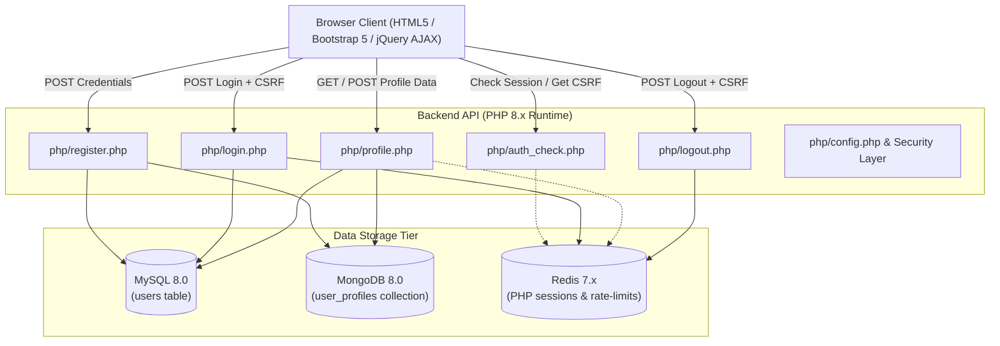
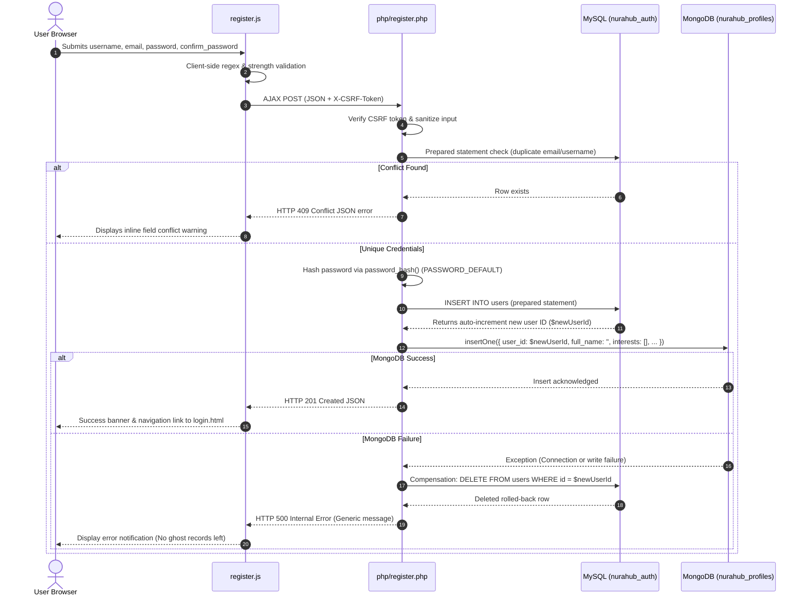
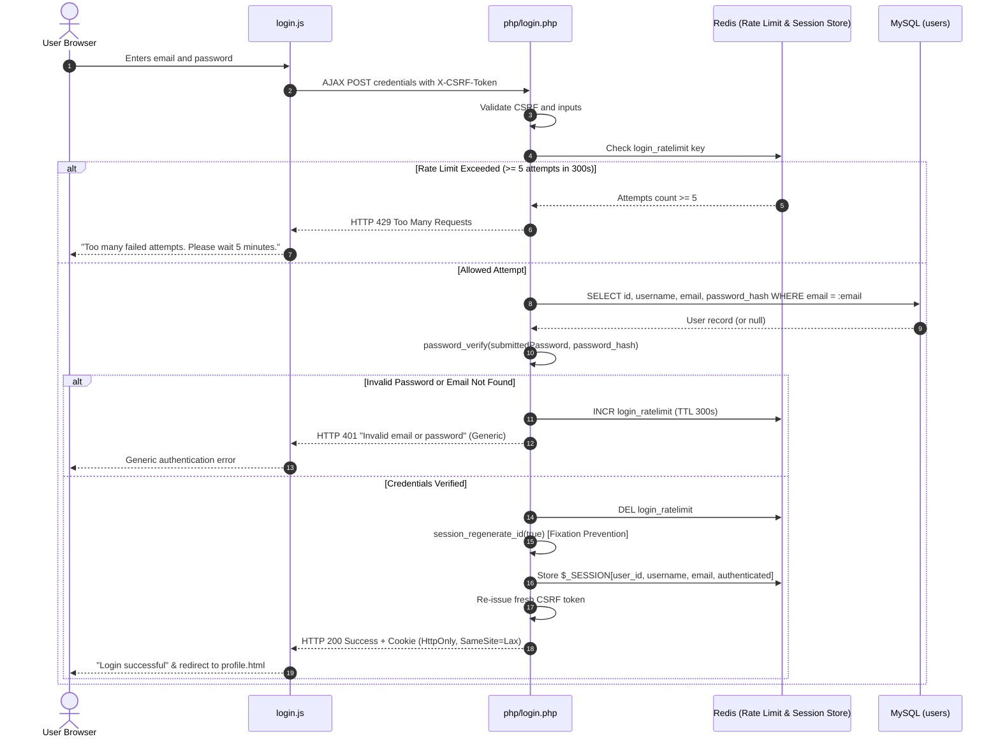
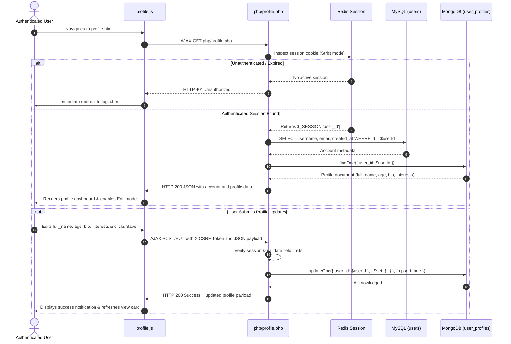
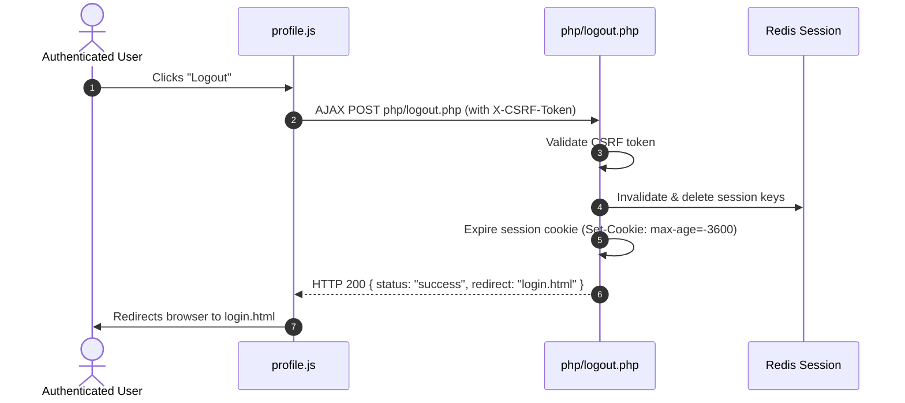

# Application Flow & Architecture Documentation

This document describes the end-to-end request lifecycle and authentication workflows implemented in the **NuraHub Secure Authentication and User Profile System**.

---

## 1. High-Level System Architecture

The application adopts a decoupled multi-tier architecture where three specialized databases handle specific domains:
- **MySQL (RDBMS):** Manages relational user account entities, constraints, and hashed credentials.
- **MongoDB (NoSQL Document Store):** Manages dynamic, semi-structured profile data (bio, age, interests tags).
- **Redis (In-Memory Key-Value Store):** Serves as the distributed session backend and enforces brute-force rate-limiting.

---

## 2. Detailed Workflows

### A. User Registration Flow

The registration endpoint guarantees cross-database consistency through an automated compensation rollback:

---

### B. User Login & Session Establishment Flow

---

### C. Authenticated Profile Access & Update Flow

---

### D. Secure Logout Flow

